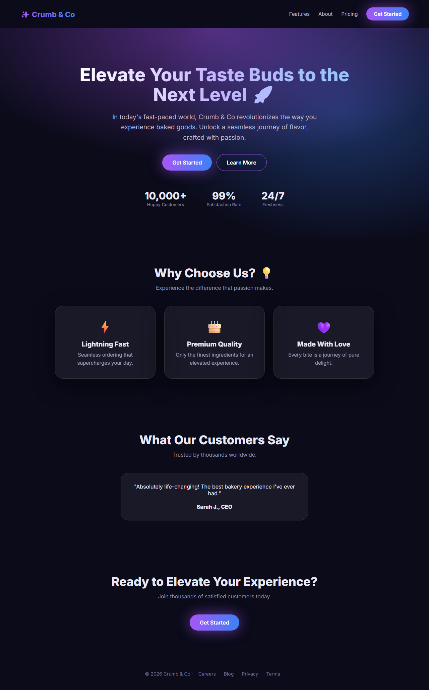
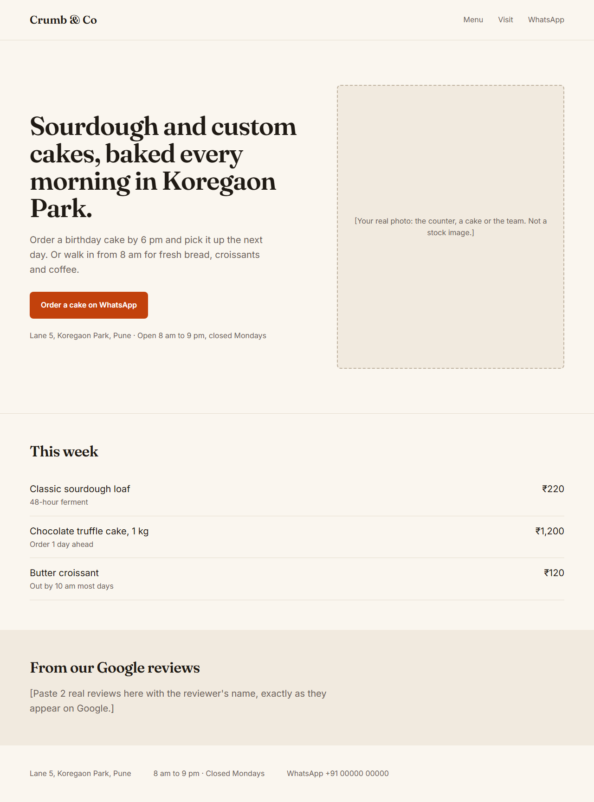

# ai-look-check: does your website look AI-made?

A free Claude skill that **scores how AI-made your website looks (0-100)**, lists every giveaway it finds, then **fixes them**.
Shared by [@aipranjal](https://www.instagram.com/aipranjal/).

| Before: 6/100 | After: 95/100 |
|---|---|
|  |  |

The demo is an example bakery page: a typical AI-made first draft, and the same page after following the skill.
The last 5 points are a real photo; the skill won't fake one.

## What it checks (15 giveaways)
Purple gradient hero, hype words ("elevate", "unlock", "seamless"), numbers with no source ("10,000+ happy customers"),
three identical feature cards, emoji icons, fake testimonials, everything centred, no type scale, glass and glow on everything,
random spacing, clashing accent colours, generic "Get Started" buttons, a headline that fits any business, no real photo,
and dead footer links.

## Install
**Claude.ai:** download [`ai-look-check.zip`](ai-look-check.zip), then Settings -> Capabilities -> Skills -> upload the zip.
**Claude Code:** copy the [`ai-look-check`](ai-look-check) folder into `~/.claude/skills/`.

Then ask: "Check my website for AI-look" (paste the HTML, a screenshot or the URL), then "Fix it".

## License
MIT, see [LICENSE](LICENSE).
